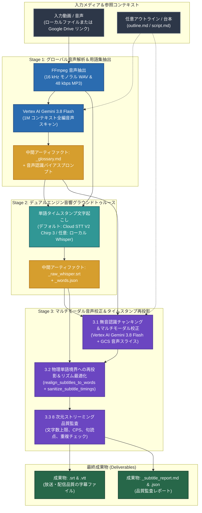

# Subtitle Craft — 放送品質 AI 字幕生成＆校正スイート

[English (en)](README.md) | [繁體中文 (zh-TW)](README.zh-TW.md) | [简体中文 (zh-CN)](README.zh-CN.md) | [日本語 (ja)](README.ja.md) | [한국어 (ko)](README.ko.md)

---

> [!IMPORTANT]
> **Google Antigravity ネイティブプラグイン＆ワークフロースイート**  
> 本ツールキットは **Google Antigravity** 向けのスタンドアロン 3 ステージ YouTube / Netflix 字幕生成＆品質監査スイートです。**Vertex AI Gemini 3.8 Flash** とデュアル音響タイムスタンプエンジン（デフォルト：**Google Cloud Speech-to-Text V2 `Chirp 3`**、オプション：**ローカル `Whisper`**）を組み合わせて動作します。

---

**Subtitle Craft** は、ローカルまたは Google Drive 上の動画・音声ファイルから、ミリ秒単位で正確に同期し専門用語を統一した字幕（`.srt` および `.vtt`）を生成します。Antigravity チャット画面で自然言語プロンプトを入力するだけで、用語集抽出、単語境界アライメント、マルチモーダル音声校正、品質監査までを自動実行します。

---

## インストールと Google Cloud セットアップ (`setup.sh`)

本プロジェクトは [Agent Plugins 1.0](https://agent-plugins.org/) に準拠し、**Google Cloud Application Default Credentials (ADC)** を用いて **Vertex AI**、**Cloud Speech-to-Text V2 (`chirp_3`)**、**Cloud Storage (GCS)** 上で動作します（API キー管理不要）。

```bash
# 1a. グローバル Antigravity Plugin としてクローン（推奨）
git clone https://github.com/sylphlin/subtitle-craft.git ~/.gemini/config/plugins/subtitle-craft

# 1b. 旧来の単一 Skill ディレクトリへのインストール（任意：skills/subtitle-craft をシンボリックリンク）
ln -s ~/.gemini/config/plugins/subtitle-craft/skills/subtitle-craft ~/.gemini/config/skills/subtitle-craft

# 2. コア依存パッケージのインストール（デフォルトの Cloud Chirp 3 + Gemini 用）と ADC 認証
brew install ffmpeg
pip install -r requirements.txt
# （任意）ローカル Whisper エンジンに切り替える場合のみインストール：
# Apple Silicon Mac: pip install mlx-whisper
# CPU / NVIDIA GPU:  pip install faster-whisper
gcloud auth application-default login

# 3. setup.sh を実行して Vertex AI・Speech-to-Text V2 API、GCS バケット、ライフサイクル、IAM、.env を構成
chmod +x setup.sh
./setup.sh --project YOUR_GCP_PROJECT_ID
```

### ディレクトリ構造（Agent Plugins 1.0 準拠）
- **SSOT 実体ディレクトリ**：`skills/subtitle-craft/`（`SKILL.md`、`scripts/generate_subtitles.py`、`scripts/modules/chirp3_asr.py`、`llm_client.py`、`gcp_client.py`、`assets/` を格納）を単一の信頼できる情報源（Single Source of Truth）として構成しています。
- **2 層 `AGENTS.md` 構成**：ルートの `AGENTS.md` は開発・エンジニアリング規約（Part I & Part II）を定義し、`rules/AGENTS.md` はプラグインに同梱される AI クライアント実行時ルール（`<PLUGIN_ROOT>` からの直接 CLI 実行、読み取り専用、Fail-Fast）を定義します。

---

## 3 ステージ・ゴールデン字幕パイプラインアーキテクチャ



---

## 2 つの音響タイムスタンプ方式とプロンプトによる呼び出し方法

Stage 2 は 2 種類の単語タイムスタンプエンジンに対応しています。CLI 引数を指定する必要はなく、Antigravity のチャットプロンプトだけで切り替えられます。

| 音響タイムスタンプ方式 | 実行環境・モデル | 主な特徴と推奨シーン | プロンプトでの呼び出し方法 |
| :--- | :--- | :--- | :--- |
| **方式 1：クラウド Chirp 3（デフォルト）** | Google Cloud Speech-to-Text V2 (`chirp_3`) | ローカル音声モデルのダウンロード不要。息継ぎ直後の発話開始時刻が正確で動画末尾まで漏れなく検出し、通常の本番運用に最適です。 | **通常の字幕生成プロンプトをそのまま送信**（エンジン指定不要で自動的に Chirp 3 を使用）。 |
| **方式 2：ローカル Whisper（任意選択）** | ローカル `mlx-whisper`（Apple Silicon）または `faster-whisper` | ローカルの GPU / CPU で単語タイムスタンプを抽出します。ローカル環境での音響処理やエンジン比較を行いたい場合に選択します。 | **プロンプト内で「Whisper を使って」「ローカル Whisper で」と明示的に指定**。 |

Antigravity では次の 2 通りの書き方が利用できます：
1. **ショートカット指定（`/skill` + `@ファイル`）**：`/subtitle-craft` を選択し、`@` で動画・音声や台本を添付します。
2. **自然言語プロンプト**：通常の会話文で要望を入力し、`@` ファイルや Google Drive リンクを添付します。

### シナリオ 1：標準の放送・配信字幕生成（デフォルトの Cloud Chirp 3 を自動使用）
- **ユースケース**：デフォルトの Cloud Chirp 3 で単語タイムスタンプを取得し、Gemini 3.8 Flash で同音異義語と専門用語を校正します。
- **方法 A（`/ + @` ショートカット指定）**：
  ```text
  /subtitle-craft ファイル: @final_cut.mp4
  ```
- **方法 B（自然言語プロンプト）**：
  ```text
  @final_cut.mp4 の日本語 YouTube 字幕を生成して、専門用語や同音異義語を校正して。
  ```
- **生成される成果物**（自動的に `<入力フォルダ>/output/` へ保存）：
  1. `final_cut.srt` および `final_cut.vtt`（放送・配信基準に準拠した字幕ファイル）。
  2. `final_cut_glossary.md`（検証済み専門用語・話者一覧）。
  3. `final_cut_subtitle_report.md` および `final_cut_subtitle_report.json`（8 次元品質監査レポート）。

### シナリオ 2：プロンプト指定でローカル Whisper エンジンに切り替える
- **ユースケース**：Stage 2 の単語タイムスタンプ抽出をローカルの Apple Silicon GPU（`mlx-whisper`）または CPU（`faster-whisper`）で実行します。
- **方法 A（`/ + @` ショートカット指定）**：
  ```text
  /subtitle-craft ファイル: @final_cut.mp4, エンジン: Whisper
  ```
- **方法 B（自然言語プロンプト）**：
  ```text
  ローカルの Whisper を使って @final_cut.mp4 の日本語 YouTube 字幕を生成し、専門用語を校正して。
  ```
- **生成される成果物**：
  1. `final_cut.srt` および `final_cut.vtt`（ローカル Whisper の単語境界に再投影された字幕）。
  2. `final_cut_glossary.md`、`final_cut_subtitle_report.md`、`final_cut_subtitle_report.json`。

### シナリオ 3：インタビュー概要や台本を参照した用語固定字幕生成
- **ユースケース**：人名リスト、ブランド表記、または台本を指定し、動画全体で用語の表記揺れを防ぎます（未指定時は Chirp 3、プロンプトで指定した場合は Whisper を使用）。
- **方法 A（`/ + @` ショートカット指定）**：
  ```text
  /subtitle-craft ファイル: @interview.mp4, 概要: @outline.md, 台本: @script.md
  ```
- **方法 B（自然言語プロンプト）**：
  ```text
  @outline.md と @script.md を用語リファレンスとして使い、@interview.mp4 の字幕を生成して。
  ```
- **生成される成果物**：
  1. `interview.srt` および `interview.vtt`（台本・概要の用語に準拠した字幕）。
  2. `interview_glossary.md`、`interview_subtitle_report.md`、`interview_subtitle_report.json`。

### シナリオ 4：Google Drive 共有リンクからの直接字幕生成
- **ユースケース**：Google Drive 上の動画・音声リンクを直接指定し、MD5 キャッシュ検証付きでダウンロードから字幕生成まで自動実行します。
- **方法 A（`/ + @` ショートカット指定）**：
  ```text
  /subtitle-craft URL: https://drive.google.com/file/d/FILE_ID/view, 言語: 日本語
  ```
- **方法 B（自然言語プロンプト）**：
  ```text
  この Google Drive 動画 https://drive.google.com/file/d/FILE_ID/view の日本語字幕と品質監査レポートを作成して。
  ```
- **生成される成果物**：
  1. `<動画名>.srt` および `<動画名>.vtt`。
  2. `<動画名>_glossary.md`、`<動画名>_subtitle_report.md`、`<動画名>_subtitle_report.json`。

---

## 3 ステージ技術概要

- **出力ディレクトリの自動分離（`<input_dir>/output/`）**：すべての成果物およびキャッシュファイルはデフォルトで `<input_dir>/output/` に出力されます（入力元がすでに `output/` の場合はネストせずそのまま再利用します）。
1. **Stage 1（Vertex AI 1M グローバル用語集抽出 — 厳格な Fail-Fast）**：**Gemini 3.8 Flash** で音声全体をスキャンし、`<basename>_glossary.md` と音声認識バイアスプロンプトを生成します。クラウドエラー発生時は即座に終了コード `1` で停止します。
2. **Stage 2（デュアルエンジン単語レベル音響グラウンドトゥルース — デフォルト `Chirp 3`、任意 `Whisper`）**：デフォルトでは Google Cloud Speech-to-Text V2 `chirp_3`（`STT_LOCATION=us`、`enableWordTimeOffsets=True`）を実行し、プロンプトで Whisper が指定された場合はローカルの `mlx-whisper` または `faster-whisper`（デフォルト `small` モデル）を実行します。`<basename>_words.json` に使用エンジン名を記録するため、エンジン切り替え時は Stage 1 の用語集を再利用したまま Stage 2 のみを自動再実行します。
3. **Stage 3（無音認識チャンキング、マルチパス非カスケード再投影＆`agent_verdict` 品質ゲート）**：
   - 自然な息継ぎ（$\ge 0.4\text{s}$）で分割し、音声チャンクとグローバル用語集を参照して同音異義語を校正します。
   - **マルチパス音響再投影（`realign_subtitles_to_words`）と均衡分割（`sanitize_subtitle_timings`）**：日中韓英の口語数値、小数点（`.`）、パーセント（`%`）、通貨記号（`$`）、桁区切り（`,`）を正規化し、無音直後の過大な先頭単語開始時刻を自動クランプ（`_clamp_inflated_word_onset`）します。チャンク全体の `difflib` マイルストーン誘導、双方向弾性ウィンドウ（`cur_char_idx - 15`）、前後アンカー間の境界付き補間によって連鎖的なタイムスタンプずれを防止します。さらに 3 階層動的計画法（3-Tier DP）で長文をバランス良く分割し、CPS に応じて $+0.4\text{s}\text{–}1.1\text{s}$ の適応型読み取りバッファ（末尾上限 `media_duration + 0.4s`）と $<0.2\text{s}$ マイクロギャップ結合を適用します。
   - `<basename>_subtitle_report.json` の最上位に `agent_verdict` を出力し、品質ゲート未達時は Agent が最大 1 回の自動修復リトライを実行します。

---

## GCS 2 階層ライフサイクルポリシー (`gs://subtitle-craft-${PROJECT_ID}`)

| GCS パス接頭辞 (`matchesPrefix`) | 保存対象 | 保持期間 (`age`) | クリーンアップ動作 |
| :--- | :--- | :--- | :--- |
| **`raw/audio_chunks/`**、**`raw/chirp3_asr_*/`** | Stage 2 / Stage 3 音声スライス | **推論直後に即時削除** | 各バッチ完了後に Python `finally` ブロックで即時削除します。 |
| **`raw/`** | 一時エピソード音声 | **2 日間 (`age: 2`)** | SHA-256 キャッシュ再利用のため 2 日間保持し、自動削除します。 |
| **`output/`**、**`deliverables/`** | SRT/VTT 字幕、監査レポート | **15 日間 (`age: 15`)** | チーム確認用に 15 日間保持した後、自動削除します。 |

---

## ライセンス (License)

本プロジェクトは [MIT License](LICENSE) の下で提供されています。
