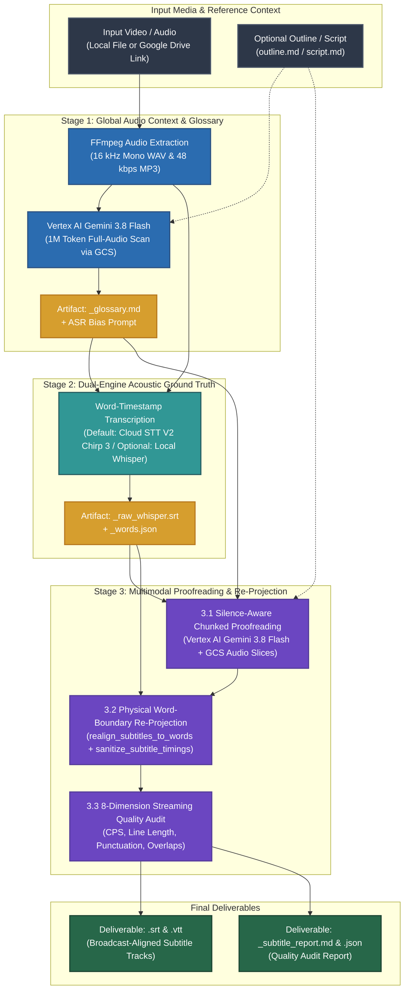

# Subtitle Craft — Broadcast-Grade AI Subtitle Suite

[English (en)](README.md) | [繁體中文 (zh-TW)](README.zh-TW.md) | [简体中文 (zh-CN)](README.zh-CN.md) | [日本語 (ja)](README.ja.md) | [한국어 (ko)](README.ko.md)

---

> [!IMPORTANT]
> **Google Antigravity Native Plugin & Workflow Suite**  
> This toolkit provides a standalone 3-stage YouTube and Netflix subtitle workflow for **Google Antigravity**, powered by **Vertex AI Gemini 3.8 Flash** and dual word-level acoustic engines (Default: **Google Cloud Speech-to-Text V2 `Chirp 3`**; Optional: **Local `Whisper`**).

---

**Subtitle Craft** converts local or Google Drive video and audio files into millisecond-accurate, terminology-consistent subtitles (`.srt` and `.vtt`). Give a natural-language prompt in the Antigravity chat window to run glossary extraction, word-timestamp alignment, multimodal audio proofreading, and quality auditing automatically.

---

## Installation & Google Cloud Setup (`setup.sh`)

This project complies with [Agent Plugins 1.0](https://agent-plugins.org/) and authenticates with **Google Cloud Application Default Credentials (ADC)** across **Vertex AI**, **Cloud Speech-to-Text V2 (`chirp_3`)**, and **Cloud Storage (GCS)**. Do not create or store API key files.

### 1. Install as an Antigravity Plugin or Skill

- **Global Plugin (Recommended)**:
  ```bash
  git clone https://github.com/sylphlin/subtitle-craft.git ~/.gemini/config/plugins/subtitle-craft
  ```
- **Legacy Single-Skill Installation (`~/.gemini/config/skills/`)**:
  Link the `skills/subtitle-craft` directory into the legacy skills directory:
  ```bash
  git clone https://github.com/sylphlin/subtitle-craft.git ~/.gemini/config/plugins/subtitle-craft
  ln -s ~/.gemini/config/plugins/subtitle-craft/skills/subtitle-craft ~/.gemini/config/skills/subtitle-craft
  ```

### 2. Install Dependencies and Provision Cloud Resources (`setup.sh`)

```bash
# 1. Install FFmpeg and core cloud Python packages (supports default Cloud Chirp 3 + Gemini)
brew install ffmpeg
pip install -r requirements.txt

# (Optional) Install a local Whisper backend only if you plan to request local Whisper:
# Apple Silicon Mac: pip install mlx-whisper
# CPU / NVIDIA GPU:  pip install faster-whisper

# 2. Authenticate Application Default Credentials (ADC)
gcloud auth application-default login

# 3. Enable Vertex AI & Speech-to-Text V2 APIs, provision GCS bucket, lifecycle rules, IAM, and .env
chmod +x setup.sh
./setup.sh --project YOUR_GCP_PROJECT_ID
```

### Directory Structure (Agent Plugins 1.0 Specification)
```text
subtitle-craft/
├── plugin.json                                     # Agent Plugins 1.0 manifest
├── rules/
│   └── AGENTS.md                                   # Packaged client execution rules (<PLUGIN_ROOT> direct CLI & fail-fast)
├── skills/
│   └── subtitle-craft/                             # Canonical Skill Bundle (Single Source of Truth)
│       ├── SKILL.md                                # Antigravity skill manifest and 3-step gated runbook
│       ├── scripts/                                # Canonical execution scripts & modules (SSOT)
│       │   ├── generate_subtitles.py               # 3-stage subtitle pipeline & 8-dimension quality audit
│       │   └── modules/                            # Chirp 3 (chirp3_asr), Vertex AI (llm_client), GCS/Drive (gcp_client), and progress modules
│       └── assets/                                 # Canonical multi-locale prompt templates (SSOT)
│           └── subtitle_proofread_template.*.md    # Language-specific YouTube/Netflix subtitle proofreading rules
├── AGENTS.md                                       # Workspace & engineering development rules (Part I & Part II)
├── setup.sh                                        # Native gcloud setup script (APIs, GCS, Lifecycle, IAM, .env)
├── pyproject.toml                                  # Python package metadata and optional dependencies
├── requirements.txt                                # Core runtime dependencies
├── .env.example                                    # Vertex AI, Cloud STT V2, and GCS configuration template
└── tests/                                          # Offline unit test suite
```

---

## End-to-End 3-Stage Golden Subtitle Architecture



---

## Acoustic Timestamp Engines & Prompt Invocation Guide

Stage 2 supports two word-level acoustic engines. Select either approach directly through your Antigravity prompt without passing command-line flags:

| Acoustic Approach | Execution Engine | Key Characteristics & When to Use | How to Invoke by Prompt |
| :--- | :--- | :--- | :--- |
| **Approach 1: Cloud Chirp 3 (Default)** | Google Cloud Speech-to-Text V2 (`chirp_3`) | Requires zero local ASR model downloads; delivers tight post-silence speech onsets and complete end-of-file coverage for production workflows. | **Send any standard subtitle prompt** (no engine mention needed; Chirp 3 runs automatically). |
| **Approach 2: Local Whisper (Optional)** | Local `mlx-whisper` (Apple Silicon) or `faster-whisper` | Runs Stage 2 word-timestamp extraction on local GPU/CPU hardware when local ASR execution or cross-engine comparison is preferred. | **Explicitly ask for "Whisper" or "local Whisper" in your prompt**. |

Use either prompt format in Antigravity:
1. **Concise Slash + Mention (`/skill` + `@file`)**: Select `/subtitle-craft` and attach your media, outline, or script with `@`.
2. **Natural Language Prompt**: State your request in plain language and attach `@` files or Google Drive links.

### Scenario 1: Standard Broadcast Subtitles (Uses Default Cloud Chirp 3)
- **Use Case**: Generate `.srt` and `.vtt` subtitles with default Cloud Chirp 3 word timestamps and Gemini 3.8 Flash terminology proofreading.
- **Mode A (`/ + @` Concise Command)**:
  ```text
  /subtitle-craft File: @final_cut.mp4
  ```
- **Mode B (Natural Language Prompt)**:
  ```text
  Generate YouTube subtitles for @final_cut.mp4 and proofread technical terms.
  ```
- **Deliverables** (saved to `<input_dir>/output/`):
  1. `final_cut.srt` and `final_cut.vtt` (Broadcast-aligned subtitle tracks).
  2. `final_cut_glossary.md` (Verified domain terminology and speaker table).
  3. `final_cut_subtitle_report.md` and `final_cut_subtitle_report.json` (8-dimension quality audit report).

### Scenario 2: Switch to Local Whisper by Prompt
- **Use Case**: Run Stage 2 word-timestamp extraction on local Apple Silicon (`mlx-whisper`) or CPU/CUDA (`faster-whisper`) instead of Cloud Chirp 3.
- **Mode A (`/ + @` Concise Command)**:
  ```text
  /subtitle-craft File: @final_cut.mp4, Engine: Whisper
  ```
- **Mode B (Natural Language Prompt)**:
  ```text
  Use local Whisper to generate YouTube subtitles for @final_cut.mp4 and proofread technical terms.
  ```
- **Deliverables**:
  1. `final_cut.srt` and `final_cut.vtt` (Aligned to local Whisper word timestamps).
  2. `final_cut_glossary.md`, `final_cut_subtitle_report.md`, and `final_cut_subtitle_report.json`.

### Scenario 3: Subtitles Anchored with an Interview Outline or Script
- **Use Case**: Supply speaker names, brand spellings, or a recording script to keep terminology consistent across the full recording (uses Chirp 3 by default, or Whisper if requested in the prompt).
- **Mode A (`/ + @` Concise Command)**:
  ```text
  /subtitle-craft File: @interview.mp4, Outline: @outline.md, Script: @script.md
  ```
- **Mode B (Natural Language Prompt)**:
  ```text
  Generate subtitles for @interview.mp4 using @outline.md and @script.md as terminology references.
  ```
- **Deliverables**:
  1. `interview.srt` and `interview.vtt` (Proofread against the provided outline and script).
  2. `interview_glossary.md`, `interview_subtitle_report.md`, and `interview_subtitle_report.json`.

### Scenario 4: Direct Subtitle Generation from a Google Drive Link
- **Use Case**: Process a video or audio file directly from a Google Drive link with remote MD5 cache verification.
- **Mode A (`/ + @` Concise Command)**:
  ```text
  /subtitle-craft URL: https://drive.google.com/file/d/FILE_ID/view, Language: zh-TW
  ```
- **Mode B (Natural Language Prompt)**:
  ```text
  Generate Traditional Chinese subtitles for https://drive.google.com/file/d/FILE_ID/view.
  ```
- **Deliverables**:
  1. `<video_name>.srt` and `<video_name>.vtt`.
  2. `<video_name>_glossary.md`, `<video_name>_subtitle_report.md`, and `<video_name>_subtitle_report.json`.

---

## Detailed Pipeline Stages

### Output Directory Isolation (`<input_dir>/output/`)
- All final and intermediate deliverables (`.srt`, `.vtt`, `_glossary.md`, `_raw_whisper.srt`, `_words.json`, `_subtitle_report.md`, `_subtitle_report.json`) are saved inside `<input_dir>/output/`. If `<input_dir>` is already named `output`, the directory is reused without creating `output/output/`.

### Stage 1: Global Audio Context & Consistency Glossary (Strict Fail-Fast)
- Compresses full episode audio to 48 kbps mono MP3, uploads it to `gs://subtitle-craft-${PROJECT_ID}/raw/`, and scans the full recording with **Vertex AI Gemini 3.8 Flash** (`1M` token context).
- Produces `<basename>_glossary.md` and extracts a compact ASR bias prompt ($\le 145$ characters) matched to the target language (`zh-TW`, `zh-CN`, `en`, `ja`, `ko`).
- Stops immediately with exit code `1` and prints remediation steps if GCS upload or Vertex AI inference fails.

### Stage 2: Dual-Engine Word-Level Acoustic Ground Truth (Default `Chirp 3`, Optional `Whisper`)
- **Default Cloud `Chirp 3`**: Calls Google Cloud Speech-to-Text V2 `chirp_3` (`STT_LOCATION=us`, `enableWordTimeOffsets=True`) with silence-aware chunking for long media, Traditional Chinese script normalization for `zh-TW`, and immediate `finally`-block cleanup of staged audio.
- **Optional Local `Whisper`**: Runs `mlx-whisper` or `faster-whisper` (`small` model by default, `word_timestamps=True`) when the user explicitly requests Whisper in the prompt.
- **Engine-Tagged Cache**: Writes `<basename>_raw_whisper.srt` and `<basename>_words.json` with the active `"asr_engine"` tag. Switching engines refreshes Stage 2 automatically while reusing Stage 1 `_glossary.md`.

### Stage 3: Silence-Aware Multimodal Proofreading, Non-Cascading Re-Projection & `agent_verdict` Audit
1. **Silence-Aware Semantic Chunking**: Splits SRT blocks at natural speech pauses ($\text{gap} \ge 0.4\text{s}$) to prevent mid-sentence cuts across chunk boundaries.
2. **Multimodal Audio-Text Proofreading (Strict Fail-Fast)**: Slices the audio segment for each chunk, uploads it to `gs://<bucket>/raw/audio_chunks/`, proofreads against both the audio waveform and Global Glossary, and deletes the remote chunk in a `finally` block. Any chunk failure cancels pending workers and exits with code `1`.
3. **Multi-Pass Word-Boundary Re-Projection & Balanced Pacing**:
   - Normalizes spoken numerals, decimals (`.`), percentages (`%`), currencies (`$`), and thousand separators (`,`) across CJK, Korean, and English while clamping inflated post-silence word onsets (`_clamp_inflated_word_onset`).
   - Projects proofread subtitle lines onto physical character timestamps (`realign_subtitles_to_words`) using chunk-level `difflib` milestone seeding, an elastic bidirectional window (`cur_char_idx - 15` lookback), and neighbor-anchor bounded interpolation onto unconsumed characters.
   - Splits overlength clauses with a 3-tier balanced Dynamic Programming cost function (`split_long_clause`), aligns sub-clauses to word boundaries with pause weighting (`align_split_clauses_with_words`), and sanitizes reading rhythm (`sanitize_subtitle_timings`: `180 ms` pre-roll, CPS-aware $+0.4\text{s}\text{–}1.1\text{s}$ post-tail buffer capped at `media_duration + 0.4s`, $<0.2\text{s}$ micro-gap bridging, and $1.0\text{s}\text{–}6.0\text{s}$ duration limits).
4. **8-Dimension Streaming Quality Audit & `agent_verdict` Gate**: Evaluates line length (`CJK <= 15`, `ko <= 16`, `Latin <= 42`), reading speed (CPS), trailing punctuation, bracket closure, Markdown cleanliness, acoustic lock rate ($\ge 80.0\%$), overlaps/micro-gaps, and prolonged silences ($\ge 10\text{s}$). Writes `agent_verdict` to `<basename>_subtitle_report.json` and runs at most one self-healing retry if the gate fails.

---

## Two-Tier GCS Bucket Lifecycle Policy (`gs://subtitle-craft-${PROJECT_ID}`)

| GCS Prefix (`matchesPrefix`) | Stored Objects | Retention (`age`) | Cleanup Mechanism |
| :--- | :--- | :--- | :--- |
| **`raw/audio_chunks/`**, **`raw/chirp3_asr_*/`** | Stage 2 / Stage 3 audio slices | **Immediate** | Deleted in Python `finally` blocks immediately after each batch completes. |
| **`raw/`** | Staged episode audio | **2 Days (`age: 2`)** | Retains SHA-256 cached staging media for 2 days, then deletes automatically. |
| **`output/`**, **`deliverables/`** | SRT/VTT subtitles and audit reports | **15 Days (`age: 15`)** | Retains deliverables for 15 days for team review before automatic deletion. |

---

## License

This project is licensed under the [MIT License](LICENSE).
