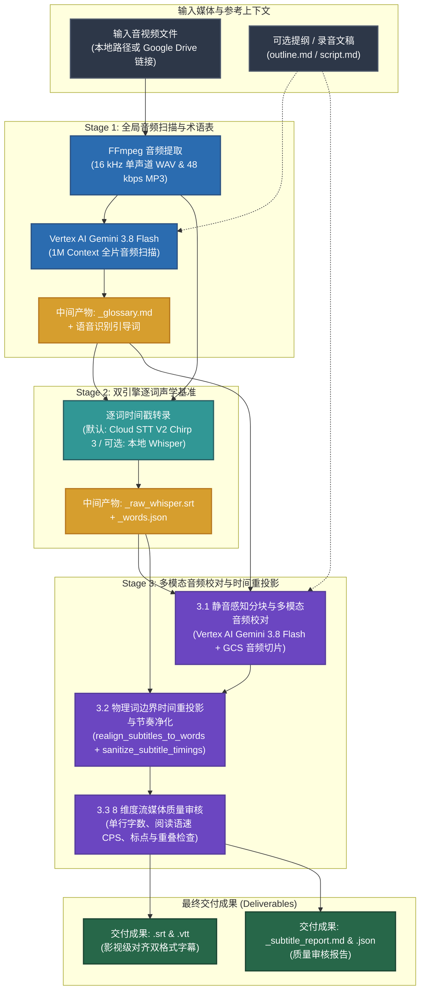

# Subtitle Craft — 影视级 AI 智能字幕生成与校对套件

[English (en)](README.md) | [繁體中文 (zh-TW)](README.zh-TW.md) | [简体中文 (zh-CN)](README.zh-CN.md) | [日本語 (ja)](README.ja.md) | [한국어 (ko)](README.ko.md)

---

> [!IMPORTANT]
> **Google Antigravity 原生技能与工作流套件**  
> 本工具集为 **Google Antigravity** 打造独立的三阶段 YouTube / Netflix 字幕生成与质量审核工作流，结合 **Vertex AI Gemini 3.8 Flash** 与双声学时间轴引擎（默认：**Google Cloud Speech-to-Text V2 `Chirp 3`**；可选：**本地 `Whisper`**）。

---

**Subtitle Craft** 将本地或 Google Drive 音视频文件转换为毫秒级对齐、专有名词一致的 `.srt` 与 `.vtt` 字幕。直接在 Antigravity 对话窗口输入自然语言提示词，即可由 Agent 自动完成术语表提取、逐词时间戳对齐、多模态听觉校对与质量审核。

---

## 安装与 Google Cloud 环境配置 (`setup.sh`)

本项目遵循 [Agent Plugins 1.0](https://agent-plugins.org/) 规范，通过 **Google Cloud Application Default Credentials (ADC)** 访问 **Vertex AI**、**Cloud Speech-to-Text V2 (`chirp_3`)** 与 **Cloud Storage (GCS)**，无需管理 API Key。

```bash
# 1a. 安装为全局 Antigravity Plugin（推荐）
git clone https://github.com/sylphlin/subtitle-craft.git ~/.gemini/config/plugins/subtitle-craft

# 1b. 旧版单一 Skill 安装（可选：将内部 skills/subtitle-craft 链接至 ~/.gemini/config/skills/）
ln -s ~/.gemini/config/plugins/subtitle-craft/skills/subtitle-craft ~/.gemini/config/skills/subtitle-craft

# 2. 安装核心云端依赖（支持默认 Cloud Chirp 3 + Gemini）与授权 ADC
brew install ffmpeg
pip install -r requirements.txt
# （可选）仅在需要切换本地 Whisper 声学引擎时安装：
# Apple Silicon Mac: pip install mlx-whisper
# 通用 CPU / NVIDIA GPU: pip install faster-whisper
gcloud auth application-default login

# 3. 运行 setup.sh 自动启用 Vertex AI 与 Speech-to-Text V2 API、配置 GCS 存储桶、生命周期规则、IAM 与 .env
chmod +x setup.sh
./setup.sh --project YOUR_GCP_PROJECT_ID
```

### 项目目录结构（Agent Plugins 1.0 标准规范）
- **SSOT 实体目录**：`skills/subtitle-craft/`（内含 `SKILL.md`、`scripts/generate_subtitles.py`、`scripts/modules/chirp3_asr.py`、`llm_client.py`、`gcp_client.py` 与 `assets/`）作为唯一真实来源（Single Source of Truth）。
- **双层 `AGENTS.md` 规范**：根目录 `AGENTS.md` 定义工作区与工程开发规范（Part I & Part II），`rules/AGENTS.md` 随 Plugin 打包注入 AI 客户端执行期守则（定位 `<PLUGIN_ROOT>` 直接调用 CLI、只读与 Fail-Fast）。

---

## 三阶段黄金字幕管线架构



---

## 两种声学时间轴方案与调用方式 (Antigravity Prompt 指南)

Stage 2 支持两种逐词声学时间轴引擎。无需输入任何命令行参数，直接通过 Antigravity 对话提示词即可选择：

| 声学引擎方案 | 运行位置与底层模型 | 核心特性与适用时机 | 如何通过 Prompt 调用 |
| :--- | :--- | :--- | :--- |
| **方案 1：云端 Chirp 3（默认）** | Google Cloud Speech-to-Text V2 (`chirp_3`) | 无需下载本地语音模型；停顿后起音定位紧致、片尾语音覆盖完整，适合日常正式字幕制作。 | **直接发送标准字幕请求**（无需指定引擎，系统默认运行 Chirp 3）。 |
| **方案 2：本地 Whisper（可选）** | 本地 `mlx-whisper`（Apple Silicon）或 `faster-whisper` | 使用本地 GPU / CPU 提取逐词时间戳，适合希望在本地运行声学转录或跨引擎对比的场景。 | **在提示词中明确说明“使用 Whisper”或“改用本地 Whisper”**。 |

在 Antigravity 中支持以下两种对话格式：
1. **极简指令（`/skill` + `@文件`）**：输入 `/subtitle-craft` 并用 `@` 附加音视频、提纲或文稿。
2. **自然语言描述**：直接用口语描述需求并附上 `@` 文件或 Google Drive 链接。

### 场景 1：标准影视级字幕生成（自动使用默认 Cloud Chirp 3）
- **适用场景**：使用默认云端 Chirp 3 获取逐词时间戳，并由 Gemini 3.8 Flash 校对同音字与技术术语。
- **方式 A（`/ + @` 极简指令）**：
  ```text
  /subtitle-craft 文件: @final_cut.mp4
  ```
- **方式 B（自然语言描述）**：
  ```text
  帮我为 @final_cut.mp4 生成简体中文 YouTube 字幕，并校对专业术语与同音字。
  ```
- **交付成果**（自动保存于 `<视频所在目录>/output/`）：
  1. `final_cut.srt` 与 `final_cut.vtt`（符合流媒体阅读节奏的双格式字幕）。
  2. `final_cut_glossary.md`（全片专有名词与发言人对照表）。
  3. `final_cut_subtitle_report.md` 与 `final_cut_subtitle_report.json`（8 维度流媒体质量审核报告）。

### 场景 2：通过提示词切换使用本地 Whisper 声学引擎
- **适用场景**：希望改由本地 Apple Silicon GPU（`mlx-whisper`）或 CPU（`faster-whisper`）执行 Stage 2 逐词时间戳提取。
- **方式 A（`/ + @` 极简指令）**：
  ```text
  /subtitle-craft 文件: @final_cut.mp4, 引擎: Whisper
  ```
- **方式 B（自然语言描述）**：
  ```text
  请改用本地 Whisper 为 @final_cut.mp4 生成简体中文 YouTube 字幕并校对专业术语。
  ```
- **交付成果**：
  1. `final_cut.srt` 与 `final_cut.vtt`（基于本地 Whisper 逐词时间轴对齐的双格式字幕）。
  2. `final_cut_glossary.md`、`final_cut_subtitle_report.md` 与 `final_cut_subtitle_report.json`。

### 场景 3：结合访谈提纲或文稿锁定专有名词
- **适用场景**：提供访谈提纲、人名列表或录音文稿，确保全片人名、品牌与领域术语一致（未指定引擎时默认使用 Chirp 3，也可在提示词中指定 Whisper）。
- **方式 A（`/ + @` 极简指令）**：
  ```text
  /subtitle-craft 文件: @interview.mp4, 提纲: @outline.md, 文稿: @script.md
  ```
- **方式 B（自然语言描述）**：
  ```text
  请参考 @outline.md 和 @script.md 中的专有名词，为 @interview.mp4 生成并校对中文字幕。
  ```
- **交付成果**：
  1. `interview.srt` 与 `interview.vtt`（依据提纲与文稿锁定术语的字幕）。
  2. `interview_glossary.md`、`interview_subtitle_report.md` 与 `interview_subtitle_report.json`。

### 场景 4：直接从 Google Drive 分享链接生成字幕
- **适用场景**：提供 Google Drive 视频或音频链接，由 Agent 自动下载（支持远程 MD5 缓存校验）并生成字幕。
- **方式 A（`/ + @` 极简指令）**：
  ```text
  /subtitle-craft 链接: https://drive.google.com/file/d/FILE_ID/view, 语言: 简体中文
  ```
- **方式 B（自然语言描述）**：
  ```text
  帮这个 Google Drive 视频 https://drive.google.com/file/d/FILE_ID/view 生成中文字幕和质量审核报告。
  ```
- **交付成果**：
  1. `<视频名称>.srt` 与 `<视频名称>.vtt`。
  2. `<视频名称>_glossary.md`、`<视频名称>_subtitle_report.md` 与 `<视频名称>_subtitle_report.json`。

---

## 三阶段核心技术说明

- **输出目录自动隔离（`<input_dir>/output/`）**：系统默认将所有最终与中间产物保存在 `<input_dir>/output/` 子目录中（若输入文件已位于 `output/` 目录则直接复用，避免嵌套 `output/output/`）。
1. **Stage 1（Vertex AI 1M 全局术语表与语音识别引导词 — 严格 Fail-Fast）**：使用 **Gemini 3.8 Flash** 扫描全片音频，生成 `<basename>_glossary.md` 与 $\le 145$ 字符的引导词；遇到云端异常立即以退出码 `1` 终止并输出修复指引。
2. **Stage 2（双引擎毫秒级逐词时间戳 — 默认 `Chirp 3`、可选 `Whisper`）**：默认调用 Google Cloud Speech-to-Text V2 `chirp_3`（`STT_LOCATION=us`、`enableWordTimeOffsets=True`）提取逐词时间偏移；当用户在提示词中指定 Whisper 时切换运行本地 `mlx-whisper` 或 `faster-whisper`（默认 `small` 模型）。缓存文件 `<basename>_words.json` 记录引擎标识，切换引擎时自动刷新 Stage 2 并复用 Stage 1 术语表。
3. **Stage 3（静音感知分块、防级联漂移重投影与 `agent_verdict` 质量门禁）**：
   - 在自然停顿处（$\ge 0.4\text{s}$）切分块，结合音频切片与全局术语表校对同音字与术语。
   - **多阶段防漂移声学重投影（`realign_subtitles_to_words`）与均衡断句（`sanitize_subtitle_timings`）**：支持中、日、韩、英口语数字、小数点（`.`）、百分比（`%`）、货币（`$`）与千分位（`,`）双向归一化对齐，自动收敛停顿后异常拉长的首词起点（`_clamp_inflated_word_onset`）；通过分块级 `difflib` 全局里程碑锚定、双向弹性字符窗口（`cur_char_idx - 15` 回溯）与前后锚点有界插值消除级联漂移；采用 3 层动态规划（3-Tier DP）均衡切分超长句，按阅读速度（CPS）在停顿处动态延伸 $+0.4\text{s}\text{–}1.1\text{s}$ 阅读缓冲（片尾上限 `media_duration + 0.4s`），并自动桥接 $<0.2\text{s}$ 微小间隙。
   - 在 `<basename>_subtitle_report.json` 顶层输出 `agent_verdict` 质量门禁（未通过门禁时由 Agent 执行最多 1 次自动修复重试）。

---

## GCS 双层生命周期规则 (`gs://subtitle-craft-${PROJECT_ID}`)

| GCS 路径前缀 (`matchesPrefix`) | 存储对象 | 保留天数 (`age`) | 清理机制 |
| :--- | :--- | :--- | :--- |
| **`raw/audio_chunks/`**、**`raw/chirp3_asr_*/`** | Stage 2 / Stage 3 音频切片 | **推理后立即删除** | 每个批次完成后在 Python `finally` 块中立即删除。 |
| **`raw/`** | 暂存完整音轨 | **2 天 (`age: 2`)** | 保留 2 天供 SHA-256 缓存复用，期满自动删除。 |
| **`output/`**、**`deliverables/`** | SRT/VTT 字幕与报告 | **15 天 (`age: 15`)** | 保留 15 天供团队审阅，期满自动清理。 |

---

## 许可证 (License)

本项目采用 [MIT License](LICENSE) 授权。
