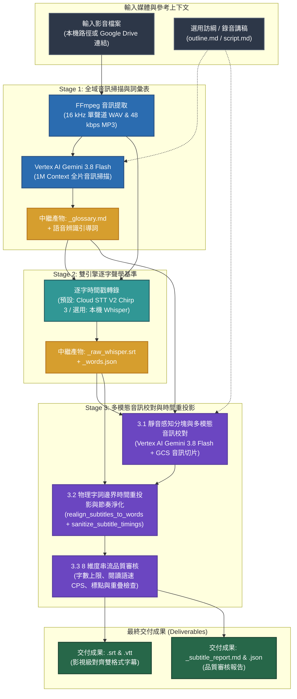

# Subtitle Craft — 影視級 AI 智慧字幕生成與校對套件

[English (en)](README.md) | [繁體中文 (zh-TW)](README.zh-TW.md) | [简体中文 (zh-CN)](README.zh-CN.md) | [日本語 (ja)](README.ja.md) | [한국어 (ko)](README.ko.md)

---

> [!IMPORTANT]
> **Google Antigravity 原生技能與工作流套件**  
> 本工具組為 **Google Antigravity** 打造的獨立三階段 YouTube / Netflix 字幕生成與品質審核套件，結合 **Vertex AI Gemini 3.8 Flash** 與雙聲學時間軸引擎（預設：**Google Cloud Speech-to-Text V2 `Chirp 3`**；選用：**本機 `Whisper`**）。

---

**Subtitle Craft** 將本機或 Google Drive 影音檔案轉換為毫秒級對齊、專有名詞一致的 `.srt` 與 `.vtt` 字幕。直接於 Antigravity 對話視窗輸入自然語言提示詞，即可由 Agent 自動完成詞彙表提取、逐字時間戳對齊、多模態聽覺校對與品質審核。

---

## 安裝與 Google Cloud 環境設定 (`setup.sh`)

本專案符合 [Agent Plugins 1.0](https://agent-plugins.org/) 規範，透過 **Google Cloud Application Default Credentials (ADC)** 存取 **Vertex AI**、**Cloud Speech-to-Text V2 (`chirp_3`)** 與 **Cloud Storage (GCS)**，無需管理 API Key。

### 1. 安裝為 Antigravity Plugin 或 Skill

- **全域 Plugin（建議）**：
  ```bash
  git clone https://github.com/sylphlin/subtitle-craft.git ~/.gemini/config/plugins/subtitle-craft
  ```
- **舊版單一 Skill 安裝（`~/.gemini/config/skills/`）**：
  將儲存庫內的 `skills/subtitle-craft` 子目錄連結至舊版 Skills 目錄：
  ```bash
  git clone https://github.com/sylphlin/subtitle-craft.git ~/.gemini/config/plugins/subtitle-craft
  ln -s ~/.gemini/config/plugins/subtitle-craft/skills/subtitle-craft ~/.gemini/config/skills/subtitle-craft
  ```

### 2. 安裝相依套件與配置雲端環境 (`setup.sh`)

```bash
# 1. 安裝 FFmpeg 與核心雲端 Python 套件（支援預設 Cloud Chirp 3 + Gemini）
brew install ffmpeg
pip install -r requirements.txt

# （選用）若需切換使用本機 Whisper 聲學引擎，請依硬體擇一安裝：
# Apple Silicon Mac: pip install mlx-whisper
# 一般 CPU / NVIDIA GPU: pip install faster-whisper

# 2. 授權 Google Cloud ADC 憑證
gcloud auth application-default login

# 3. 執行 setup.sh 自動啟用 Vertex AI 與 Speech-to-Text V2 API、配置 GCS 儲存桶、雙層生命週期、IAM 與 .env
chmod +x setup.sh
./setup.sh --project YOUR_GCP_PROJECT_ID
```

### 專案目錄結構（Agent Plugins 1.0 標準規範）
```text
subtitle-craft/
├── plugin.json                                     # Agent Plugins 1.0 宣告清單
├── rules/
│   └── AGENTS.md                                   # 隨 Plugin 封裝之客戶端執行守則（唯讀、直接呼叫與 Fail-Fast）
├── skills/
│   └── subtitle-craft/                             # 技能套件唯一真實來源（Single Source of Truth）
│       ├── SKILL.md                                # 技能規範與三階段執行手冊
│       ├── scripts/                                # 核心腳本與模組目錄 (SSOT)
│       │   ├── generate_subtitles.py               # 三階段字幕管線與 8 維度品質審核主程式
│       │   └── modules/                            # Chirp 3 (chirp3_asr)、Vertex AI (llm_client)、GCS/Drive (gcp_client) 與進度模組
│       └── assets/                                 # 多語系字幕校對提示詞範本目錄 (SSOT)
│           └── subtitle_proofread_template.*.md    # 支援 zh-TW, zh-CN, en, ja, ko 之 YouTube/Netflix 斷句規範
├── AGENTS.md                                       # 工作區與開發工程規範（Part I 執行守則 & Part II 開發規範）
├── setup.sh                                        # 原生 gcloud 雲端環境一鍵配置腳本
├── pyproject.toml                                  # Python 套件定義與選用相依設定
├── requirements.txt                                # 核心執行期相依套件清單
├── .env.example                                    # Vertex AI、Cloud STT V2 與 GCS 環境變數範本
└── tests/                                          # 離線單元測試套件
```

---

## 三階段黃金字幕管線架構



---

## 兩種聲學時間軸做法與呼叫方式 (Antigravity Prompt 操作指南)

Stage 2 支援兩種逐字聲學時間軸引擎。使用者無需記憶或輸入任何指令列參數，直接透過 Antigravity 對話提示詞即可切換：

| 聲學引擎做法 | 執行位置與底層模型 | 核心特性與適用時機 | 如何以 Prompt 呼叫 |
| :--- | :--- | :--- | :--- |
| **做法 1：雲端 Chirp 3（預設）** | Google Cloud Speech-to-Text V2 (`chirp_3`) | 免安裝本機語音模型；換氣停頓後起音定位精準、片尾語音覆蓋完整，適合大多數正式製作流程。 | **直接下達標準字幕指令**（不需特別指定引擎，系統自動採用 Chirp 3）。 |
| **做法 2：本機 Whisper（選用）** | 本機 `mlx-whisper`（Apple Silicon）或 `faster-whisper` | 運用本機 GPU / CPU 擷取逐字時間戳，適合希望在本地端執行聲學轉錄或進行跨引擎對照之場景。 | **在提示詞中明確提及「使用 Whisper」或「改用本機 Whisper」**。 |

在 Antigravity 中可使用以下兩種對話格式下達指令：
1. **極簡指令（`/skill` + `@檔案`）**：輸入 `/subtitle-craft` 並用 `@` 附加影音檔、訪綱或講稿。
2. **自然語言描述**：直接以口語描述需求並附上 `@` 檔案或 Google Drive 連結。

### 情境 1：標準影視級字幕生成（自動使用預設 Cloud Chirp 3）
- **適用場景**：使用預設雲端 Chirp 3 擷取逐字時間軸，並由 Gemini 3.8 Flash 校對同音字與技術專有名詞。
- **方式 A（`/ + @` 極簡指令）**：
  ```text
  /subtitle-craft 檔案: @final_cut.mp4
  ```
- **方式 B（自然語言描述）**：
  ```text
  幫我為 @final_cut.mp4 產生繁體中文 YouTube 字幕，並校對技術專有名詞與同音字。
  ```
- **交付成果**（自動收納於 `<影片所在目錄>/output/`）：
  1. `final_cut.srt` 與 `final_cut.vtt`（符合串流閱讀節奏的雙格式字幕）。
  2. `final_cut_glossary.md`（全片專有名詞與講者對照表）。
  3. `final_cut_subtitle_report.md` 與 `final_cut_subtitle_report.json`（8 維度串流品質審核報告）。

### 情境 2：指定改用本機 Whisper 聲學引擎
- **適用場景**：希望改由本機 Apple Silicon GPU（`mlx-whisper`）或 CPU（`faster-whisper`）執行 Stage 2 逐字聲學時間戳擷取。
- **方式 A（`/ + @` 極簡指令）**：
  ```text
  /subtitle-craft 檔案: @final_cut.mp4, 引擎: Whisper
  ```
- **方式 B（自然語言描述）**：
  ```text
  請改用本機 Whisper 幫 @final_cut.mp4 產生繁體中文 YouTube 字幕並完成專有名詞校對。
  ```
- **交付成果**：
  1. `final_cut.srt` 與 `final_cut.vtt`（以本機 Whisper 字詞時間軸完成重投影之雙格式字幕）。
  2. `final_cut_glossary.md`、`final_cut_subtitle_report.md` 與 `final_cut_subtitle_report.json`。

### 情境 3：結合訪綱或錄音講稿強化專有名詞一致性
- **適用場景**：提供訪談大綱、人名清單或錄音文稿，確保全片人名、品牌與領域術語一致（同樣可在提示詞中自由指定 Whisper，未指定則預設使用 Chirp 3）。
- **方式 A（`/ + @` 極簡指令）**：
  ```text
  /subtitle-craft 檔案: @interview.mp4, 大綱: @outline.md, 講稿: @script.md
  ```
- **方式 B（自然語言描述）**：
  ```text
  請參考 @outline.md 與 @script.md 的專有名詞，幫 @interview.mp4 產生並校對繁體中文字幕。
  ```
- **交付成果**：
  1. `interview.srt` 與 `interview.vtt`（依據訪綱與講稿鎖定術語之字幕）。
  2. `interview_glossary.md`、`interview_subtitle_report.md` 與 `interview_subtitle_report.json`。

### 情境 4：直接從 Google Drive 分享連結產生字幕
- **適用場景**：傳入 Google Drive 影片或音訊連結，由 Agent 自動下載（支援遠端 MD5 快取驗證）並完成字幕產製。
- **方式 A（`/ + @` 極簡指令）**：
  ```text
  /subtitle-craft 連結: https://drive.google.com/file/d/FILE_ID/view, 語言: 繁體中文
  ```
- **方式 B（自然語言描述）**：
  ```text
  幫這個 Google Drive 影片 https://drive.google.com/file/d/FILE_ID/view 產生繁體中文雙格式字幕與品質審核報告。
  ```
- **交付成果**：
  1. `<影片名稱>.srt` 與 `<影片名稱>.vtt`。
  2. `<影片名稱>_glossary.md`、`<影片名稱>_subtitle_report.md` 與 `<影片名稱>_subtitle_report.json`。

---

## 三階段核心技術說明

- **輸出目錄自動隔離（`<input_dir>/output/`）**：系統預設將所有最終與中繼產物（`.srt`、`.vtt`、`_glossary.md`、`_raw_whisper.srt`、`_words.json`、`_subtitle_report.md`、`_subtitle_report.json`）收納於 `<input_dir>/output/` 子目錄；若輸入檔案已位於 `output/` 目錄下則直接重用，避免產生 `output/output/` 巢狀目錄。
1. **Stage 1（全域音訊掃描與詞彙表提取 — 嚴格 Fail-Fast）**：壓縮全片音訊並上傳至 `gs://subtitle-craft-${PROJECT_ID}/raw/`，透過 **Vertex AI Gemini 3.8 Flash**（`1M` Context）產出 `<basename>_glossary.md` 與對應語系的語音辨識引導詞（$\le 145$ 字元）。若發生雲端權限或連線錯誤，立即以狀態碼 `1` 終止並輸出修復步驟。
2. **Stage 2（雙引擎毫秒級逐字聲學時間戳 — 預設 `Chirp 3`、選用 `Whisper`）**：
   - **預設雲端 `Chirp 3`**：呼叫 Google Cloud Speech-to-Text V2 `chirp_3`（`STT_LOCATION=us`、`enableWordTimeOffsets=True`），支援長音訊靜音感知分段、繁體中文字體正規化，並於推論後立即清理暫存音訊。
   - **選用本機 `Whisper`**：使用者於提示詞指定時，啟動 `mlx-whisper` 或 `faster-whisper`（預設 `small` 模型，`word_timestamps=True`）。
   - **引擎標記快取**：將字詞時間戳與所屬引擎名稱寫入 `<basename>_words.json`；切換聲學引擎時會自動重跑 Stage 2 並直接重用 Stage 1 詞彙表。
3. **Stage 3（靜音感知分塊、防漂移聲學重投影與 `agent_verdict` 品質閘門）**：
   - 於自然換氣停頓處（$\ge 0.4\text{s}$）切分區塊，比對音訊切片與全域詞彙表修正同音字（雲端錯誤立即取消佇列並以狀態碼 `1` 終止）。
   - **多階段防漂移聲學重投影（`realign_subtitles_to_words`）與均衡斷句（`sanitize_subtitle_timings`）**：
     - **多語系口語數詞正規化與停頓後首字收斂**：支援中、日、韓、英口語數字、小數點（`.`）、百分比（`%`）、貨幣（`$`）與千分位（`,`）雙向正規化對齊，並收斂停頓後異常拉長的首字起點（`_clamp_inflated_word_onset`）。
     - **全域里程碑錨定與雙向鄰居有界內插**：以區塊級 `difflib` 全域匹配里程碑引導搜尋視窗（`cur_char_idx - 15` 回溯），將未鎖定行按字數比例內插至前後鎖定行之間尚未消耗的字元時間軸，消除連鎖時間漂移。
     - **三階層動態規劃均衡斷句與 CPS 感知動態尾韻**：以 3-Tier DP 成本函數切分超長句，結合編輯距離與停頓加權對齊子句（`align_split_clauses_with_words`），依閱讀速率（CPS）於停頓處延展 $+0.4\text{s}\text{–}1.1\text{s}$ 閱讀尾韻（片尾上限鎖定於 `media_duration + 0.4s`），並自動橋接 $<0.2\text{s}$ 微小間隙。
   - **8 維度串流品質審核與 `agent_verdict` 閘門**：於 `<basename>_subtitle_report.json` 頂層寫入 `agent_verdict`（檢核 `acoustic_lock_rate_pct >= 80.0%`、`last_out_vs_duration_diff_sec <= 0.5s` 與零重疊）。若未通過品質閘門，Agent 最多執行 1 次自動修復重試。

---

## GCS 雙層生命週期規則 (`gs://subtitle-craft-${PROJECT_ID}`)

| GCS 路徑前綴 (`matchesPrefix`) | 儲存內容 | 保留天數 (`age`) | 清理機制 |
| :--- | :--- | :--- | :--- |
| **`raw/audio_chunks/`**、**`raw/chirp3_asr_*/`** | Stage 2 / Stage 3 音訊切片 | **推論後立即刪除** | 每個批次完成後於 Python `finally` 區塊立即刪除。 |
| **`raw/`** | 暫存完整音軌 | **2 天 (`age: 2`)** | 保留 2 天供 SHA-256 快取重用，期滿自動刪除。 |
| **`output/`**、**`deliverables/`** | SRT/VTT 字幕與審核報告 | **15 天 (`age: 15`)** | 保留 15 天供團隊下載與審閱，期滿自動清理。 |

---

## 授權條款 (License)

本專案採用 [MIT License](LICENSE) 授權。
